# LAIKA 64

LAIKA 64 is a Nintendo 64 emulator for the Xbox 360. It runs on modded consoles (RGH or JTAG) and starts like any other homebrew, from Aurora, FreeStyle Dash or another dashboard. The name comes from Laika, the first animal to orbit Earth.

LAIKA 64 is built on [Harissa64](#credits-and-licence) by kernel64. On top of it, it brings a new interface, HD texture packs, a faster recompiler and many new options. It's a hobby project: a lot of games already run at full speed, a few are still slow in busy scenes, and most of the library hasn't been tried yet. The [games list](docs/games.md) shows how games run, with the version they were tested on. Add your own results there.

Use it only with games you own. No ROMs are included, and none will be.

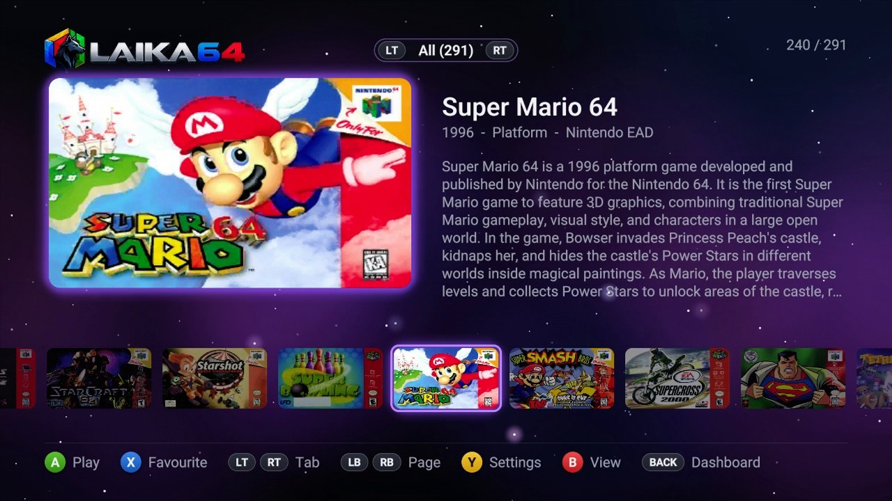

## What you need

- An Xbox 360 with RGH or JTAG and a dashboard such as Aurora.
- A controller. Up to four players are supported.
- Your N64 games as `.z64`, `.n64`, `.v64` or `.zip` files.

## Installing

1. Copy the LAIKA 64 folder (with `default.xex` inside) to your console, for example to `Hdd1:\Emulators\LAIKA 64\`.
2. Make a `roms` folder next to the `.xex` and put your games in it.
3. Scan the folder in your dashboard, then start LAIKA 64.

The first time, a welcome assistant (with its own music) sets things up with you: language, controller, picture, colours and background. Eight languages are available: English, Spanish, French, German, Portuguese (Brazil), Italian, Russian and Arabic. You can run the assistant again from **Settings > System**.

In Aurora LAIKA 64 shows up with its own cover and background: they are in the `art` folder, load them from the game's asset manager.

## The game library

- **Six views**: detailed list, grid, big covers, carousel, mosaic and spotlight. B switches between them.
- **Pictures for every game**: box art (flat or as a 3D box), a screenshot, the title screen and the logo. The right stick goes through them; stay on a game for a moment and they take turns by themselves, with a soft fade.
- **Game info**: real title, year, developer, genre, players, region, a description, the ROM size and its save type.
- **Translated descriptions**: the games' descriptions show in the menus' language when Wikipedia has the article in it (**Settings > Interface > Translate descriptions**; off, in English).
- **Favourites and categories**: X marks a favourite; LT/RT go through the tabs. You can make your own categories by genre, region, players, developer, publisher or year.
- **USB memories**: plug one in while the game list is up and LAIKA 64 offers to add its games (from any folder on it). They get their own **USB** tab, and leave the list when the memory is taken out.
- **File explorer** (Settings > System > Tools): two panels over the hard drive and USB memories, to copy, move and delete files on the console.
- **Screenshots of the menus** with L3 + R3.
- **About and Credits** pages: X in the game list.

| | |
|---|---|
| 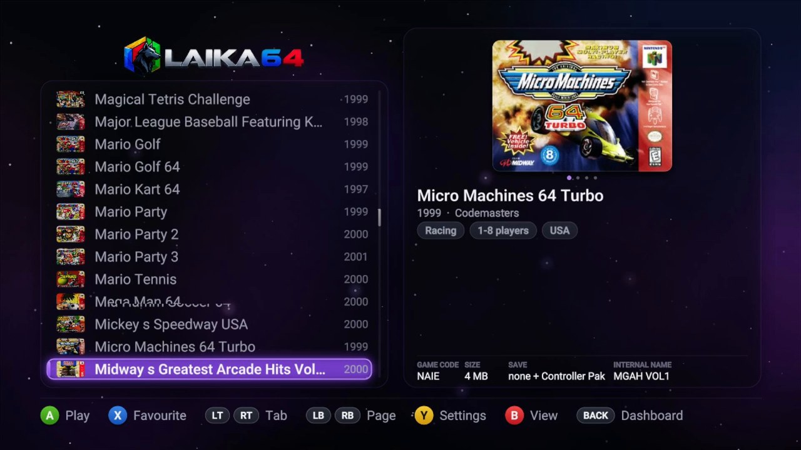 | 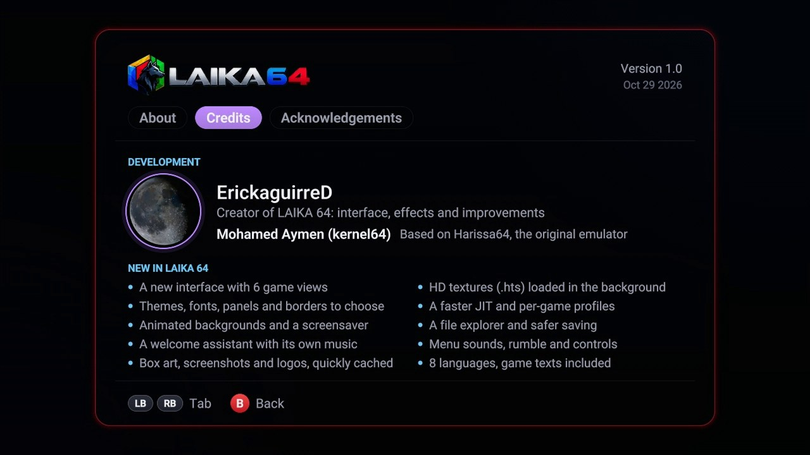 |

## Box art and game info

When the console is online, LAIKA 64 downloads the pictures and information by itself the first time a game is shown, and keeps them in the `art\games` folder next to the `.xex`. After that they show up straight away, even offline. Box art is kept in a compressed cache so large libraries open quickly.

In **Settings > Interface > Game images** you choose which picture the list shows and what is downloaded: **box art downloads** (box art and game information) and, on their own row, **screenshot and logo downloads** (pictures from the game, title screens and logos). Every game's pictures are downloaded in one go in the background (all four kinds with screenshot and logo downloads on), and **Get box art for all games** in Settings tries again what was missing. With **Download while playing** on, the downloads go on during a game, with a note when they start and when they end.

No internet on the console? Run the script on a PC instead (you need [Python 3](https://www.python.org)):

```
python tools/fetch_game_art.py "C:\path\to\your\roms"
```

It fills an `art\games` folder: copy it to the console, into the LAIKA 64 folder. Games it can't find just show their initials.

The pictures and the text come from [libretro-thumbnails](https://github.com/libretro-thumbnails/Nintendo_-_Nintendo_64), [libretro-database](https://github.com/libretro/libretro-database), [GameDB-N64](https://github.com/niemasd/GameDB-N64) and Wikipedia. They are not part of LAIKA 64.

## Make it yours

Everything is in **Settings > Interface**, and the welcome assistant goes through the main ones:

- **29 animated backgrounds**: Nebula, Hyperspace, Aurora, XMB wave, Flow, Bokeh, Lava, Fractal, Hologram and more, each with its own colours, opacity and speed.
- **Your own wallpapers**: JPG or PNG files in the `wallpapers` folder, changing by themselves with fade, slide, zoom, wipe, blinds or random transitions.
- **Screen saver**: the background effect, your wallpapers, a floating logo or a clock.
- **Six fonts**: Roboto, Inter, Montserrat, Nunito, Orbitron and Press Start 2P.
- Selection colour, settings style, text size, borders (colour, width, glow: steady, pulsing, snake, fade, rainbow), panel opacity and corners.
- **Menu music** (in order, random or one track, from the `music` folder) and interface sounds in four styles.

| | | |
|---|---|---|
| 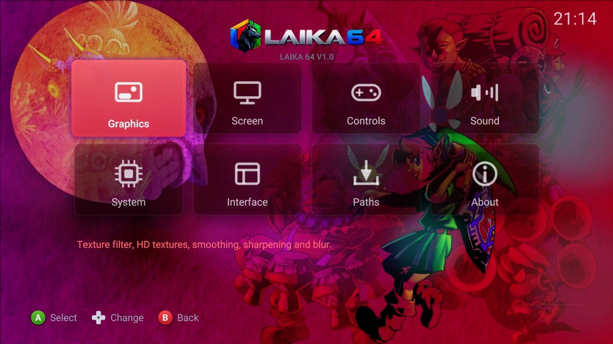 | 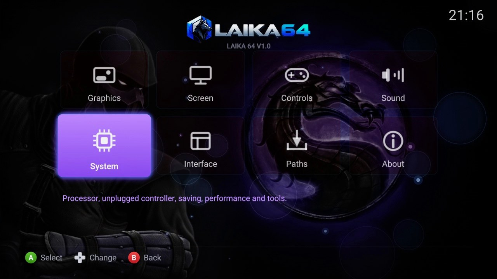 | 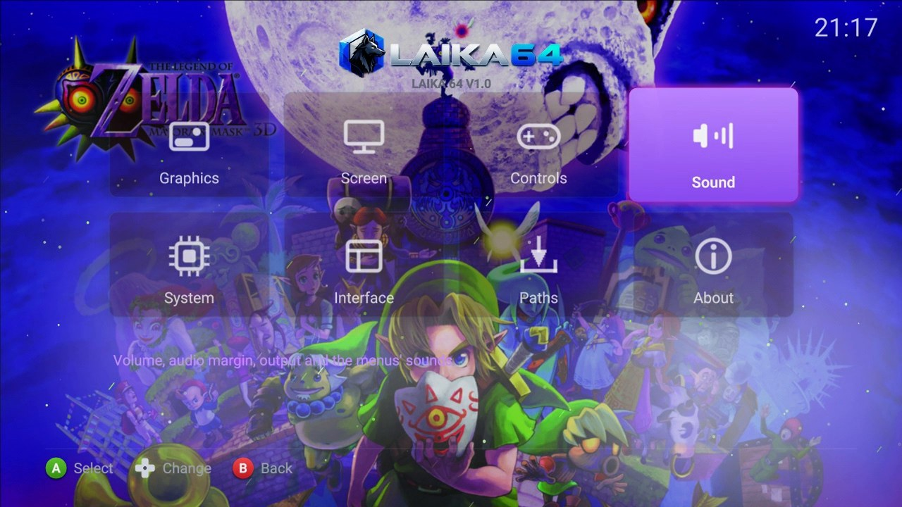 |

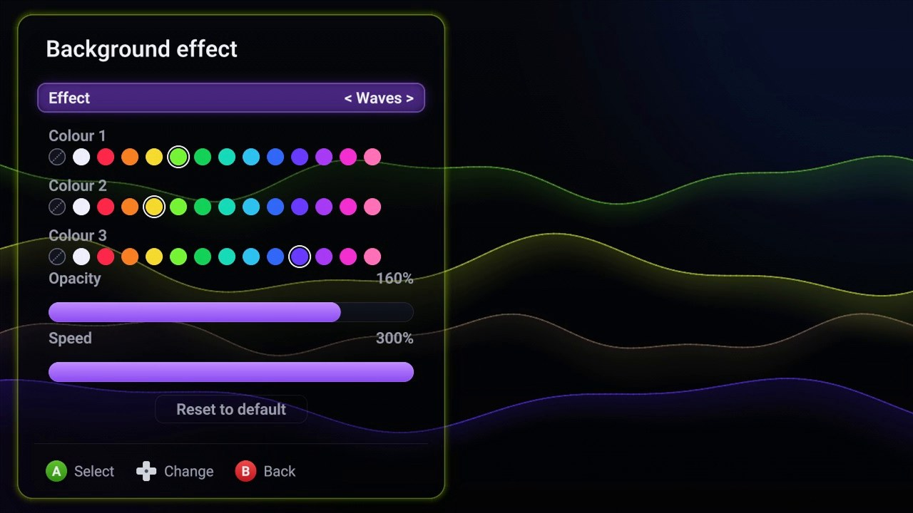

## HD textures

LAIKA 64 loads HD texture packs in the `.hts` format (the GLideN64 format). Put them in `hires_texture\<GAME NAME>\`, for example `hires_texture\SMASH REMIX\`. The folder is named after the game's internal name (the one in its ROM header). In **Settings > Graphics > HD textures** you turn them on and pick the pack when there are several (Y previews them).

Packs load in the background, so the game doesn't wait for them. **Two clicks of R3** in game turn the HD textures on and off to compare; the shortcut can be switched off in **Settings > Controls > Button shortcuts**.

### Making a pack

`tools/make_hts.py` builds a `.hts` pack from a folder of PNG files named the usual Rice / GLideN64 way (the names texture packs are shared with, and that GLideN64 or Project64 dump):

```
pip install pillow
python tools/make_hts.py "C:\packs\SUPER MARIO 64" "SUPER MARIO 64.hts"
```

Names look like `SUPER MARIO 64#3C2D8A1F#0#2_all.png` (and a palette checksum after the size for colour-indexed textures). Sub-folders are read too. `--max 2048` scales down very large textures, which then load faster and take less memory on the console. Copy the `.hts` to `hires_texture\<GAME NAME>\`. `tools/hts_dump.py` shows what a pack holds.

## Performance

- An optimised JIT recompiler, with per-game profiles for games that need them (GoldenEye, Perfect Dark, Quake and others).
- ROMs larger than 64 MB, such as Smash Remix.
- An on-screen performance monitor (**Settings > System > On-screen performance**): frame rate, CPU load, RAM in use, resolution and the CPU, GPU and RAM temperatures, with its position, size and colour. 60 FPS is full speed (50 for European games). It depends on the game: some still slow down in busy scenes.

## Controls

| Xbox 360 | N64 |
|---|---|
| Left stick | Analog stick |
| A | A |
| X | B (where B sits on the N64 controller, left of A) |
| LT | Z |
| LB / RB | L / R |
| Right stick | C buttons |
| D-pad | D-pad |
| START | START |

You can change these in **Settings > Controls**, where the N64 controller is drawn on screen: pick a button, press A, then press the Xbox button or stick direction you want for it. Y adds a second button, X clears it. **Auto setup** asks for each N64 button in turn. Each player (1 to 4) has their own controls, and you can save them for all games or for one game. The same page has the **stick calibration** (dead zone, sensitivity, response curve, a guided calibration and a test) and the Rumble Pak switch.

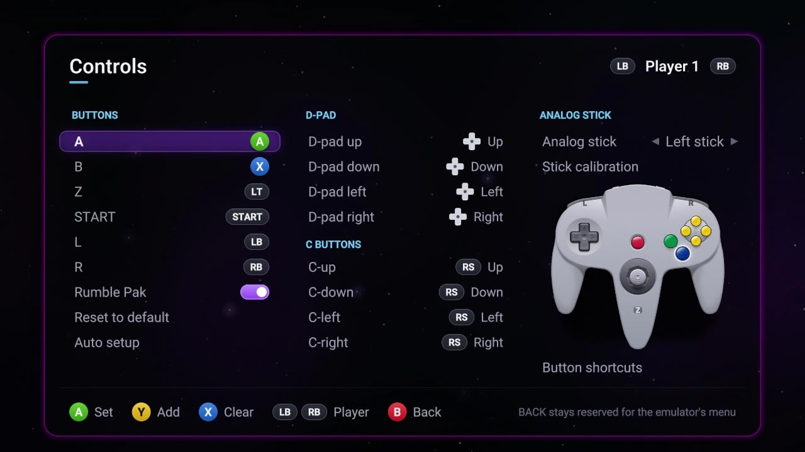

| | | |
|---|---|---|
| 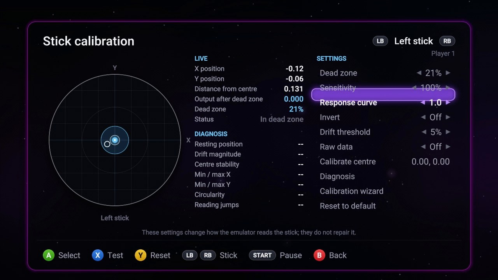 | 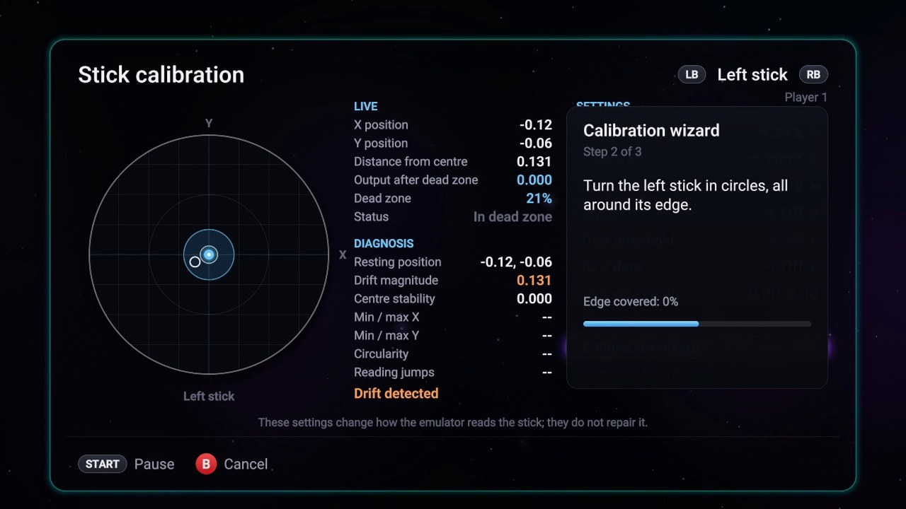 | 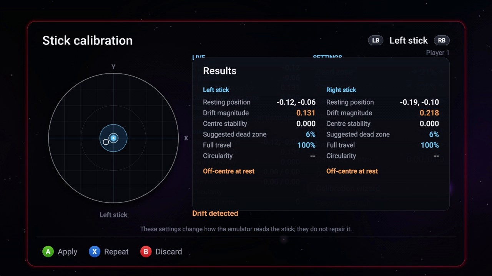 |

While playing:

- **Short press on BACK**: pause and open the menu (save or load a state, settings, reset, back to the game list, quit).
- **BACK + RB**: save a state. **BACK + LB**: load it.
- **BACK + D-pad left/right**: change the state slot (1 to 9).
- **Two clicks of R3**: HD textures on or off.
- **Hold BACK for 3 seconds**: back to the game list.

These shortcuts can be changed in **Settings > Controls > Button shortcuts**. **Settings > System** also sets what happens when a controller is unplugged (pause the game, save and pause, or nothing) and a low battery warning.

## Saves

Your in-game saves (EEPROM, SRAM, FlashRAM and Controller Pak) are kept automatically, one folder per game, in `saves\<game name> <code>\` next to the `.xex`. Save states go in the same folder: nine slots, each with a picture of the moment, and a confirmation before overwriting. Copy that folder somewhere if you want a backup.

## Settings

Open the menu in a game, or press Y in the game list, then **Settings**. You can save the settings for all games or just for the game you're playing.

The **Graphics** page has five presets:

- **Recommended**: 1366x768 widescreen, bilinear filtering, colours as they are.
- **Original**: the plain N64 picture.
- **N64 Enhanced**: smoother textures and a little sharpening.
- **N64 Smooth**: the same with light scanlines.
- **N64 CRT**: looks like an old TV.

You can also pick the resolution (4:3, or 16:9 up to 1366x768, where the 3D view gets wider instead of being stretched; it works better in some games than others), texture filtering, FXAA, sharpness, blur, anti-flicker, screen effects (scanlines, CRT, LCD grid and others), brightness and colour styles (vivid, warm, cool, sepia, black and white, retro green...).

Every setting is explained in [docs/settings.md](docs/settings.md).

## Updates

When a new version is published on [GitHub](https://github.com/ErickaguirreD/Laika64/releases), LAIKA 64 says so in the game list and offers to install it. It downloads the new `default.xex`, checks it (an Xbox 360 executable whose SHA-1 matches the release's `default.xex.sha1`), keeps the version you had as `default.xex.bak` and starts again. To go back, rename `default.xex.bak` to `default.xex`. The check can be turned off with `updatecheck=0` in `config\settings.ini`.

## Good to know

- Some games show a black screen for about 4 seconds when they start. That's the cartridge's own boot check, it's normal.
- If a game misbehaves, try the other CPU mode in **Settings > System** (the interpreter is much slower but useful to compare), and tell us about it.

## Building

You need Visual Studio 2010 and the Xbox 360 SDK. Open `platform/xbox360/harissa64v2.sln` and build the Release configuration for the Xbox 360 platform, or run `build_release.ps1`, which also packs the release folder.

## Credits and licence

LAIKA 64 is developed by ErickaguirreD. It is based on **Harissa64**, the original emulator by **Mohamed Aymen (kernel64)**: thanks to him for the work everything here stands on.

LAIKA 64 is free software under the GPL v2, see [LICENSE](LICENSE). Some parts come from or are based on other open-source projects (ares, ParaLLEl-RDP, mupen64plus, libdragon, GLideN64, minimp3, stb, zlib and others), with display filters by Timothy Lottes and AMD. The interface uses the Inter, Roboto, Montserrat, Nunito, Orbitron, Press Start 2P and Noto Sans Arabic fonts. [THIRD_PARTY.md](THIRD_PARTY.md) lists them with their licences. Thanks to all of them, and to the Xbox 360 and N64 community that tests every release.

Nintendo 64 is a trademark of Nintendo. This project is not affiliated with or endorsed by Nintendo.
